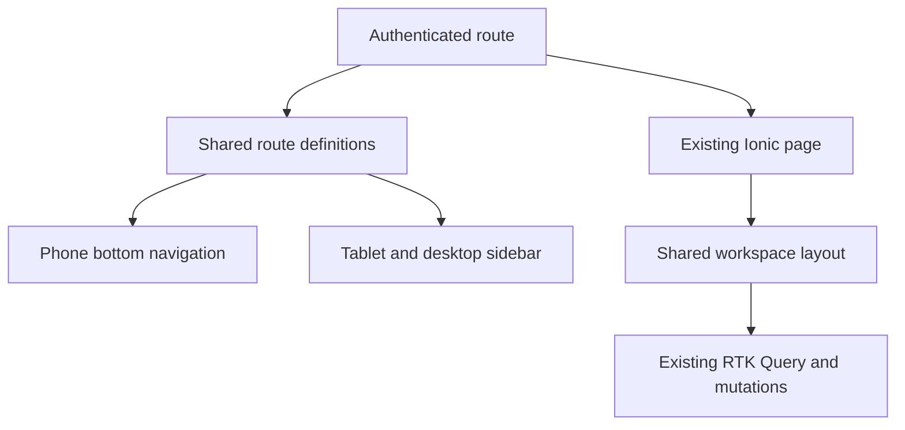

# Shopkeeper Workspace Remap - Plan

## Goal Capsule

- **Objective:** A shop owner or staff member can find the next useful action and read operational records comfortably on a phone, tablet, or desktop without losing existing POS workflows.
- **Means:** Reuse the responsive billing layout language, introduce shared page and navigation patterns, and remap the existing screens without changing their API contracts (KTD1, KTD2).
- **Authority:** This plan follows the user's owner-first, multi-staff, four-language, `dev`-based direction. Existing invoice, tenant, and permission contracts remain authoritative.
- **Execution profile:** UI code and fixture-backed browser checks. Railway deployment and live database checks occur after development.
- **Stop conditions:** Do not present a planned capability as working, weaken a permission check, or change payment/invoice behavior during a visual remap.
- **Delivery:** Open a PR into `dev`; merging requires the user's explicit approval.

---

## Product Contract

### Summary

Give the existing POS screens a consistent shopkeeper workspace with clear owner priorities, role-aware navigation, readable records, and actions that remain discoverable at every screen size.

### Problem Frame

Fast walk-in billing now has a useful responsive layout, but most management pages remain narrow lists with inconsistent actions. An owner needs to see sales, pending invoices, and stock concerns quickly. Staff still need the current create, edit, payment, and drill-down flows without relearning a different menu on every device.

### Requirements

**Navigation and orientation**

- R1. A user sees the same permitted destinations through one route definition, with a phone bottom bar and a grouped wider-screen sidebar.
- R2. Existing URLs, authenticated routes, and role-filtered actions continue to work, including direct links to detail pages.
- R3. A detail page opened without in-app history can return to its corresponding list.

**Owner and operational work**

- R4. The dashboard gives today's sales, pending invoices, and low stock clear priority, with direct links to their existing workflows.
- R5. Customers, Products, Inventory, Invoices, Payments, Suppliers, Purchases, Reports, Users, Categories, and Import/Export use consistent page widths, headings, actions, and readable mobile/tablet/desktop records.
- R6. Search, filters, refresh, pagination, infinite scroll, modals, file preview, and existing mutations keep their behavior after the remap.
- R7. Actions hidden in a swipe or floating button on a phone are also discoverable by mouse and keyboard on wider screens.

**Quality and language**

- R8. Touched interface copy is translated in English, Hindi, Marathi, and Gujarati and remains readable with long labels and amounts.
- R9. Loading, empty, and fetch-error states give distinct, useful feedback where the remap touches a data view.
- R10. Cashier billing remains the fast walk-in path; the Payments screen continues to mean customer-linked collections.

### Key Decisions

- **Owner-first, multi-staff workspace** (session-settled: user-directed — chosen over an owner-only POS: the shop uses multiple staff members). Governs R1, R2, R4, R5.
- **No deployment or live database work in this development phase** (session-settled: user-directed — chosen over restarting Railway now: deployment follows completed development). Governs R6, R9.

### Acceptance Examples

- AE1. An OWNER opens Dashboard on a phone and can start Billing, inspect pending Invoices, or inspect low Inventory without scrolling past six equal cards. Covers R4.
- AE2. A CASHIER sees only their permitted destinations in the sidebar and bottom bar, while walk-in checkout remains available. Covers R1, R2, R10.
- AE3. A manager opens a purchase detail URL directly and can return to Purchases; the same route works from Reports. Covers R2, R3.
- AE4. On desktop a customer can be edited with a visible action, and on a phone the existing touch action remains usable. Covers R6, R7.
- AE5. Search with no matches says what happened; a failed request offers retry rather than looking like an empty shop. Covers R9.

### Scope Boundaries

This is a presentation and navigation change. It does not change server authorization or claim that hiding a menu entry protects a route. The dashboard API currently exposes its six totals to authenticated users; a financial-visibility policy needs a separate server decision.

#### Deferred to Follow-Up Work

- Held bills across counters, shift opening/closing cash, offline billing queue, smart reorder, and WhatsApp intake/reminders require separate data or external-service contracts.
- The final clickable workflow sketch will follow the implemented product flows so it demonstrates what actually works.
- Railway restart, migration execution, and live end-to-end verification follow the development phase.

---

## Planning Contract

### Key Technical Decisions

- KTD1. **One navigation model.** Define destinations, groups, icons, route matches, and permissions once; render the phone and wide-screen navigation from it so they cannot drift. This implements R1 and R2.
- KTD2. **Shared page layout, existing data hooks.** Add reusable page width, header, action, status, and record styles while retaining each screen's RTK Query hooks and Ionic page boundaries. This implements R5 and R6.
- KTD3. **Role-aware links, unchanged authorization.** Filter dashboard shortcuts with existing role permissions and keep server mutation checks; a new route guard or server privacy policy is outside this UI slice. This implements R2 and R4.
- KTD4. **Fixture-backed visual verification.** Use mocked data for phone, tablet, desktop, dark mode, long local-language labels, and failure states while Railway is paused. This implements R8 and R9.

### High-Level Technical Design

### Assumptions

- Retain the current five primary phone destinations by role and place all permitted destinations in the wider sidebar. This is an agent choice pending visual feedback.
- Lead the owner dashboard with today's sales, pending invoices, and low stock; do not infer trends or cash balances from the current aggregates.
- Keep the existing financial totals visible to any authenticated role until a separate server policy is agreed.
- The sketch will show implemented flows and place future capabilities in a visibly marked roadmap view.

### Research Anchors

- `src/features/billing/BillingPage.tsx` and `src/index.css` provide the current responsive/touch pattern.
- `src/App.tsx`, `src/layouts/MainLayout.tsx`, `src/components/SideMenu/SideMenu.tsx`, and `src/core/permissions/rolePermissions.ts` define routing and visible permissions.
- `src/features/reports/ReportsPage.tsx` links purchase register rows to singular `/purchase/:id`, while `src/App.tsx` registers `/purchases/:id`.

---

## Implementation Units

### U1. Shared navigation and workspace primitives

- **Goal:** Give every role a consistent route map and every screen reusable responsive layout pieces.
- **Requirements:** R1, R2, R5, R7, R8.
- **Dependencies:** None.
- **Files:** `src/layouts/MainLayout.tsx`, `src/components/SideMenu/SideMenu.tsx`, `src/components/SideMenu/SideMenu.css`, `src/components/Navbar.tsx`, `src/core/permissions/rolePermissions.ts`, new shared workspace components/styles, `src/core/i18n/locales/{en,hi,mr,gu}.json`, `src/components/SideMenu/SideMenu.test.tsx`.
- **Approach:** Drive both navigation surfaces from the same role-filtered route definitions. Give the main content a responsive width and keep accessible focus and touch targets.
- **Patterns to follow:** Existing `MainLayout`, `SideMenu`, `Navbar`, and billing layout.
- **Test scenarios:** OWNER, MANAGER, and CASHIER receive only their permitted navigation items; active route selection follows direct navigation; phone and wider navigation expose the same permitted destinations.
- **Verification:** Navigation and layout render without duplicate or clipped controls at phone, tablet, and desktop widths.

### U2. Owner dashboard

- **Goal:** Make owner priorities and next actions visible without inventing new business metrics.
- **Requirements:** R4, R8, R9, R10.
- **Dependencies:** U1.
- **Files:** `src/features/dashboard/DashboardPage.tsx`, `src/features/dashboard/DashboardPage.test.tsx`, `src/core/i18n/locales/{en,hi,mr,gu}.json`.
- **Approach:** Use existing six dashboard values, put the three operational priorities first, and filter shortcuts by role.
- **Test scenarios:** Populated dashboard links to Billing, Invoices, and Inventory according to role; a failed stats request shows retry; zero values remain visible; cashier never receives an Inventory shortcut.
- **Verification:** Owner and cashier views are clear on phone, tablet, and desktop while pull refresh still works.

### U3. Sales and customer records

- **Goal:** Make Customers, Invoices, and Payments readable and actionable at every width.
- **Requirements:** R5, R6, R7, R8, R9, R10.
- **Dependencies:** U1.
- **Files:** `src/features/customers/CustomersPage.tsx`, `src/features/invoices/InvoicesPage.tsx`, `src/features/payments/PaymentsPage.tsx`, their existing styles and focused tests, `src/core/i18n/locales/{en,hi,mr,gu}.json`.
- **Approach:** Keep search/status/date behavior, offer visible desktop row actions, and label customer collections distinctly from walk-in checkout.
- **Test scenarios:** Search and status filtering still select records; an authorized user can open/edit a customer without swiping on desktop; an empty search and failed fetch differ; manual customer payment remains customer-linked.
- **Verification:** Existing billing and payment tests remain green, and records stay readable with long names and amounts.

### U4. Catalog, stock, and purchasing

- **Goal:** Make stock maintenance and supplier purchasing easy to scan without altering inventory rules.
- **Requirements:** R5, R6, R7, R8, R9.
- **Dependencies:** U1.
- **Files:** `src/features/products/ProductsPage.tsx`, `src/features/inventory/InventoryPage.tsx`, `src/features/suppliers/SuppliersPage.tsx`, `src/features/purchases/PurchasesPage.tsx`, focused tests, `src/core/i18n/locales/{en,hi,mr,gu}.json`.
- **Approach:** Use consistent header actions and adaptive record layouts; retain modals, scanning paths, low-stock warnings, and purchase creation.
- **Test scenarios:** Low-stock item opens its existing edit action; product search/pagination remains intact; supplier ledger and purchase creation routes open; unavailable data shows a retry state.
- **Verification:** Phone controls do not overlap the bottom bar, and tablet/desktop records use available width.

### U5. Reports and management screens

- **Goal:** Make Reports, Users, Categories, and Import/Export understandable on all devices.
- **Requirements:** R5, R6, R7, R8, R9.
- **Dependencies:** U1.
- **Files:** `src/features/reports/ReportsPage.tsx`, `src/features/reports/ReportsPage.test.tsx`, `src/features/users/UsersPage.tsx`, `src/features/categories/CategoriesPage.tsx`, `src/features/import-export/ImportExportPage.tsx`, related styles, `src/core/i18n/locales/{en,hi,mr,gu}.json`.
- **Approach:** Keep report queries and import validation, make section choices and primary actions visible, and fix the purchase-register drill-down to the registered route.
- **Test scenarios:** A purchase-register row opens `/purchases/:id`; report selection keeps the chosen query/result; category and staff actions remain permitted and visible; import preview and validation remain intact.
- **Verification:** All four locales render these pages without clipped actions or raw English labels introduced by this change.

### U6. Detail navigation and cross-screen proof

- **Goal:** Complete the remap through detail/ledger pages and prove primary workflows still connect.
- **Requirements:** R2, R3, R6, R8, R9.
- **Dependencies:** U2, U3, U4, U5.
- **Files:** `src/features/invoices/InvoiceDetailPage.tsx`, `src/features/products/ProductDetailPage.tsx`, `src/features/customers/CustomerLedgerPage.tsx`, `src/features/suppliers/SupplierLedgerPage.tsx`, `src/features/purchases/{PurchaseDetailPage,CreatePurchasePage}.tsx`, focused navigation tests, `src/core/i18n/locales/{en,hi,mr,gu}.json`.
- **Approach:** Make back links reliable for direct visits and align headings/actions with the shared layout without changing transactions.
- **Test scenarios:** Direct invoice, product, customer ledger, supplier ledger, and purchase URLs return to their lists; in-app navigation still honors history; create purchase and invoice payment flows remain reachable.
- **Verification:** Run the UI test suite, lint, build, and fixture-backed browser walkthrough at 390px, 768px, and 1440px in light and dark themes.

---

## Verification Contract

- `npm test` proves role/navigation and touched feature behavior with mocked API data.
- `npm run lint` catches style and hook regressions.
- `npm run build` proves the TypeScript and production bundle contract.
- Fixture-backed browser walkthrough covers Dashboard, Billing, each remapped main screen, detail back navigation, long translated labels, and loading/empty/error states at phone, tablet, and desktop widths.
- Live API and migration checks are deferred until Railway deployment resumes.

---

## Definition of Done

- All existing main and detail routes remain reachable, and role-filtered navigation matches the existing permission map.
- The six dashboard values retain their meaning; owner shortcuts use existing destinations.
- Touched pages use the shared layout, show their primary actions at relevant widths, and retain their queries and mutations.
- All new visible copy exists in English, Hindi, Marathi, and Gujarati.
- Focused tests, lint, build, and fixture-backed responsive browser checks pass; abandoned layout experiments are removed from the diff.
- A PR into `dev` links this plan and states that Railway/database verification is deferred.
