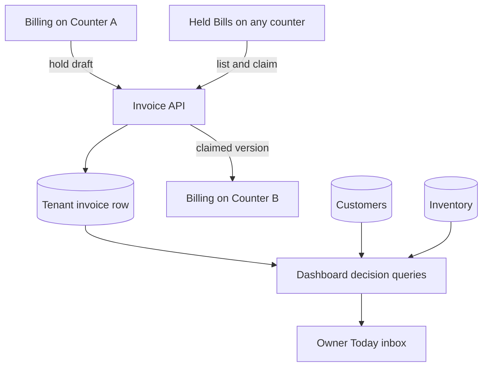
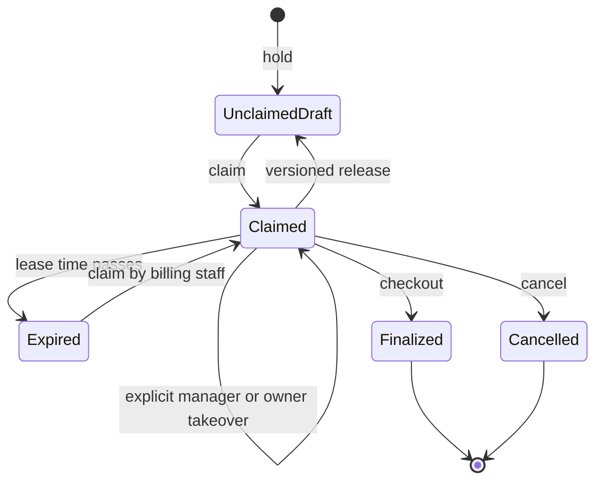

# Owner Decision Inbox and Held-Bill Relay - Plan

**Target repositories:** `kirana-server` and `kirana-ui`

## Goal Capsule

- **Objective:** Owners can see the few shop decisions that need attention now, while cashiers can hold a sale on one counter and resume it safely on another without overwriting somebody else's work.
- **Means:** Extend draft invoices into versioned, time-bounded work packets and return record-linked owner decisions from the existing dashboard API. (KTD1, KTD2)
- **Authority:** Product behavior in R1-R10 overrides implementation convenience; KTDs own the implementation mechanism.
- **Execution profile:** Server contract and mocked tests first, then responsive Ionic UI and localized copy.
- **Stop conditions:** Do not claim production concurrency until the migration and multi-session behavior have been verified against MySQL; do not require Railway for ordinary unit tests.
- **Finish and ship:** Compound Engineering verifies, reviews, commits, pushes, and opens separate PRs into `dev`; merging remains an explicit user decision.

---

## Product Contract

### Summary

This plan turns the owner home into a short decision queue and promotes draft invoices into visible held bills that can move safely between counters. The first release stays rule-based and explainable, with no autonomous ordering, messaging, or offline synchronization.

### Problem Frame

The dashboard currently reports aggregate totals, so an owner still has to open several screens to learn which customer, product, or bill needs attention. Draft invoices already preserve a cart, but resumption is buried in invoice filters and two staff members can edit the same draft without an ownership or freshness signal.

### Actors

- A1. **Owner:** reviews prioritized money, stock, and held-bill decisions and opens the relevant record.
- A2. **Manager:** sees the operational queue, may claim an expired or unclaimed bill, and may explicitly take over an actively leased bill.
- A3. **Cashier:** holds a bill, resumes bills they hold or unclaimed bills, and sees when another counter owns the edit lease.

### Requirements

**Owner decisions**

- R1. The owner dashboard shows three ranked decision groups—money to collect, low stock to review, and held bills needing attention—with at most three records in each group. Money decisions include active customers with a positive balance ordered by amount; stock decisions include variants at or below their threshold ordered by threshold ratio; held-bill decisions include only unclaimed or expired held bills ordered oldest first.
- R2. Every decision identifies its source record, explains why it matters now, and offers one primary navigation action.
- R3. Decision ordering is deterministic and explainable from stored values; the first release does not predict demand or take action automatically.
- R4. A missing or failed decision feed does not hide existing dashboard totals or quick actions.

**Held-bill continuity**

- R5. Holding a sale creates an unclaimed held draft and stores its authenticated creator, originating counter label, item count, amount, hold time, and version. The holder and lease expiry remain empty until the bill is claimed or taken over.
- R6. Staff can list held bills separately from completed invoices and open the selected draft directly in Billing.
- R7. An unclaimed or expired held bill can be claimed by any billing-capable staff member; an active lease held by someone else stays read-only unless an OWNER or MANAGER explicitly takes it over.
- R8. Updating, releasing, finalizing, or cancelling a held bill requires the caller's expected version and current-holder ownership. A stale version returns a conflict without overwriting newer work; an OWNER or MANAGER must explicitly take over another user's active lease before changing or cancelling it.
- R9. A claimed held bill has a 15-minute lease based on the server's UTC clock. The lease is active only when a holder exists and `lease_expires_at` is strictly later than the current server time; it renews on an accepted draft update and through a conditional five-minute activity renewal while Billing remains open, and it clears on release, finalization, or cancellation.
- R10. Held-bill actions remain tenant-scoped and use the authenticated user identity rather than trusting holder details from the client.

**Experience and release boundaries**

- R11. Mobile presents held bills as touch-friendly cards and desktop/tablet presents the same information without hiding actions behind hover behavior.
- R12. All new user-facing copy exists in English, Hindi, Marathi, and Gujarati.
- R13. Ordinary server tests mock Prisma and run without Railway or `DATABASE_URL`; real migration and concurrency checks remain separately gated.

### Key Decisions

- **Deliver owner decisions and held bills together** (session-settled: user-approved — chosen over another aggregate-dashboard pass: the owner needs actions while counters need continuity). Governs R1-R10.
- **Keep Jira out of this product phase** (session-settled: user-directed — chosen over the demo workflow: Jira was only required for the earlier process demonstration). Governs the delivery workflow, not runtime behavior.
- **Keep the first release rule-based** (session-settled: user-approved — chosen over predictive recommendations: current data supports explainable exceptions but not trustworthy forecasting). Governs R1-R3.

### Key Flows

- F1. **Hold and relay a sale**
  - **Trigger:** A cashier pauses a non-empty bill.
  - **Actors:** A3, optionally A2.
  - **Steps:** Save as draft with hold metadata; show it in the held-bill queue; claim it on another counter; load it into Billing; update or finalize with the claimed version.
  - **Outcome:** One staff member has the edit lease and stale clients cannot overwrite the bill.
  - **Covered by:** R5-R10.
- F2. **Owner acts from the inbox**
  - **Trigger:** The owner opens Today or refreshes the dashboard.
  - **Actors:** A1.
  - **Steps:** Load totals and decision records; inspect the reason; open the customer, stock, or held-bill destination.
  - **Outcome:** The owner reaches the record needing action without searching through reports.
  - **Covered by:** R1-R4.

### Acceptance Examples

- AE1. **Covers R7-R8:** Given Counter A holds a bill at version 2, when Counter B tries to update version 2 without a permitted takeover, then the API rejects the write and preserves Counter A's draft.
- AE2. **Covers R7-R9:** Given a held bill's lease has expired, when a cashier claims it, then the holder, counter, expiry, and version change atomically and Billing opens the claimed draft.
- AE2a. **Covers R8-R9:** Given a cashier releases a claimed bill using its current version, when the server accepts the release, then it preserves the draft, clears the holder and lease, increments the version, and makes the bill claimable.
- AE3. **Covers R1-R4:** Given no customers owe money but two products are below threshold, when the owner opens Today, then the low-stock decisions appear with product links while sales totals remain visible.
- AE4. **Covers R4:** Given the decision query fails but aggregate statistics are available, when the dashboard renders, then totals and quick actions remain usable with a retryable decision-feed message.

### Success Criteria

- A cashier can hold and resume a two-item walk-in bill from the responsive UI without selecting a customer.
- A stale held-bill edit is rejected and the newer server state is recoverable without data loss.
- An owner reaches a customer, inventory item, or held bill from its dashboard card in one action.
- Server unit tests, UI tests, lint, type checks, and production builds run without the deployed API or database.

### Scope Boundaries

#### Deferred to Follow-Up Work

- Persistent snooze, assign, and dismiss-with-reason actions for owner decisions.
- Real-time cross-counter updates through sockets or polling shorter than normal cache refresh.
- Shift opening and closing, offline billing queue, smart reorder generation, and WhatsApp list compilation.
- Unknown-barcode product creation from the billing scanner.
- Railway deployment, MySQL migration execution, and real multi-session concurrency verification.

#### Considered and Not Built

- A second cart store outside invoices: draft invoices already provide the durable transaction boundary and another store would create reconciliation work.
- Silent last-write-wins fallback: a conflict could lose a customer's active bill before staff notice it.
- Automatic manager takeover: takeover changes edit ownership and must remain an explicit visible action.

---

## Planning Contract

### Key Technical Decisions

- KTD1. **Draft invoices remain the held-bill record.** Add hold metadata and an optimistic version to `Invoice` rather than creating a parallel cart entity; the existing create, update, finalize, cancel, audit, and tenant checks stay authoritative for R5-R10.
- KTD2. **A 15-minute server-owned lease controls editing.** Claim and takeover operations set holder, counter, expiry, and incremented version atomically; clients send only the counter label plus the expected version. A conditional renewal runs every five minutes only while a claimed draft is actively open, and stops when Billing exits or backgrounds. This makes conflicts explicit without adding a queue or real-time service.
- KTD3. **The dashboard returns independently available decision records as well as totals.** Extend `/dashboard/stats` with a `decision_inbox` object whose three tenant-scoped groups expose availability plus up to three records. Aggregate statistics are calculated independently and decision queries settle without rejecting the entire request. Each record carries a stable type, priority, reason inputs, and destination identifiers.
- KTD4. **The UI degrades each region independently.** Existing totals and quick actions render when decision records are absent, while the held-bill queue has its own loading, empty, conflict, and retry states.
- KTD5. **Database-dependent proof stays gated.** Prisma repositories and services receive mocked unit coverage; migration and concurrent-claim integration tests run only when `TEST_DATABASE_URL` is supplied.

### High-Level Technical Design

### Sequencing

1. Add the persistent hold/version contract and server tests.
2. Add tenant-scoped held-bill operations and decision records.
3. Add UI API types, held-bill queue, conflict recovery, and responsive owner inbox.
4. Complete translations, documentation, full verification, simplification, and review.

---

## Implementation Units

### U1. Persist held-bill ownership and versioning

- **Goal:** Give draft invoices the durable metadata required for cross-counter ownership and stale-write detection.
- **Requirements:** R5, R8-R10, R13.
- **Dependencies:** None.
- **Files:**
  - `kirana-server/prisma/schema.prisma`
  - `kirana-server/prisma/migrations/<timestamp>_add_held_bill_relay/migration.sql`
  - `kirana-server/src/modules/invoice/invoice.service.ts`
  - `kirana-server/src/modules/invoice/invoice.validation.ts`
  - `kirana-server/src/modules/invoice/invoice.validation.test.ts`
  - `kirana-server/src/modules/invoice/invoice.service.test.ts`
- **Approach:** Store creator, holder, originating/current counter, hold and lease timestamps, update timestamp, and version on `Invoice`. The explicit hold operation sets `held_at`, which distinguishes a relayed bill from other drafts, but creates no active holder. Require expected version and holder ownership on held-draft mutation and clear lease fields on release or terminal transitions.
- **Execution note:** Start with failing service and validation tests using mocked Prisma; do not require a live database.
- **Patterns to follow:** Customer and inventory optimistic-lock updates in the existing services; tenant filters in invoice reads.
- **Test scenarios:**
  - Creating a draft records the authenticated creator and initial hold metadata without requiring a customer.
  - Updating with the current version changes the draft, renews the lease, and increments the version once.
  - Updating with a stale version returns a conflict and performs no item deletion or invoice mutation.
  - Finalizing or cancelling a held draft clears holder and lease metadata.
  - Cancelling with a stale version or as a non-holder leaves status, items, and ownership unchanged.
  - The exact expiry boundary uses a controlled server clock: an expiry equal to now is expired.
- **Verification:** Generated Prisma types, server unit tests, lint, and build pass without `DATABASE_URL`.

### U2. Expose held-bill relay operations

- **Goal:** Let staff list, claim, release, and explicitly take over tenant-scoped held bills.
- **Requirements:** R6-R10; F1; AE1-AE2.
- **Dependencies:** U1.
- **Files:**
  - `kirana-server/src/modules/invoice/invoice.routes.ts`
  - `kirana-server/src/modules/invoice/invoice.controller.ts`
  - `kirana-server/src/modules/invoice/invoice.validation.ts`
  - `kirana-server/src/modules/invoice/invoice.service.ts`
  - `kirana-server/src/modules/invoice/invoice.repository.ts`
  - `kirana-server/src/modules/invoice/invoice.relay.test.ts`
- **Approach:** Define a held bill as an invoice with `status = DRAFT` and a non-null `held_at`. Add bounded held-bill listing plus atomic claim, renew, release, and takeover endpoints; infer actor and permissions from JWT, allow takeover only for OWNER/MANAGER, and return conflict details suitable for UI recovery. Release preserves the draft, clears holder and lease expiry, and increments the version atomically.
- **Patterns to follow:** Existing invoice route permissions, controller serialization, and tenant-scoped repository queries.
- **Test scenarios:**
  - A cashier lists only held DRAFT invoices from their tenant with item/customer/holder summaries; unrelated drafts are excluded.
  - A cashier claims an unclaimed or expired bill and receives the incremented version.
  - A cashier cannot claim another user's active lease.
  - An OWNER or MANAGER can take over an active lease only through the explicit takeover operation.
  - A versioned release clears the active lease and makes the draft claimable without deleting it.
  - Active-screen renewal extends only the current holder's matching version and stops after the screen closes or backgrounds.
  - A request using another tenant's invoice ID receives not found rather than leaking metadata.
- **Verification:** Route, validation, service, and repository tests prove the relay contract without a live database.

### U3. Return the Owner Decision Inbox contract

- **Goal:** Replace aggregate-only oversight with a bounded list of actionable customer, stock, and held-bill records.
- **Requirements:** R1-R4; F2; AE3-AE4.
- **Dependencies:** U1.
- **Files:**
  - `kirana-server/src/modules/dashboard/dashboard.service.ts`
  - `kirana-server/src/modules/dashboard/dashboard.controller.ts`
  - `kirana-server/src/modules/dashboard/dashboard.service.test.ts`
- **Approach:** Preserve existing statistics and return a role-aware `decision_inbox`: OWNER and MANAGER receive three independently settled groups with availability and up to three deterministic records, while CASHIER receives no owner financial decision records. Keep every query tenant-scoped and avoid predictive labels.
- **Patterns to follow:** Existing receivable, low-stock, and draft-invoice queries plus dashboard response serialization.
- **Test scenarios:**
  - Highest customer balances rank first and include customer identifiers and due amounts.
  - Lowest stock relative to threshold ranks first and includes product/variant identifiers.
  - Oldest held bills rank first and distinguish active, expired, and unclaimed leases.
  - Empty categories return empty arrays while aggregate totals remain unchanged.
  - A failed decision query marks only its group unavailable while the response retains aggregate totals and successful groups.
  - A CASHIER response contains existing aggregate statistics but no owner decision records.
- **Verification:** Mocked Prisma tests assert tenant filters, ordering, bounded result sizes, and response shape.

### U4. Build the responsive held-bill relay UI

- **Goal:** Make held bills visible and resumable from Billing on mobile, tablet, and desktop.
- **Requirements:** R5-R12; F1; AE1-AE2.
- **Dependencies:** U1, U2.
- **Files:**
  - `kirana-ui/src/core/types/index.ts`
  - `kirana-ui/src/core/api/invoiceApi.ts`
  - `kirana-ui/src/features/billing/BillingPage.tsx`
  - `kirana-ui/src/features/billing/BillingPage.test.tsx`
  - `kirana-ui/src/features/billing/HeldBillsPanel.tsx`
  - `kirana-ui/src/features/billing/HeldBillsPanel.css`
  - `kirana-ui/src/features/billing/HeldBillsPanel.test.tsx`
- **Approach:** Place a `Held bills (count)` trigger beside the Billing heading. Open a full-height Ionic sheet on mobile and a right-side overlay on tablet/desktop while preserving the underlying cart and returning focus to the trigger on close. Store the trimmed 1–32 character counter label as a per-device setting, prompt only when absent, and expose an Edit counter action. Load claimed drafts through the existing edit path, provide a secondary Release bill action for the current holder, and recover from version conflicts by offering refresh rather than overwriting.
- **Patterns to follow:** Existing Billing draft hydration, RTK Query invalidation, workspace responsive primitives, and notification service.
- **Test scenarios:**
  - Holding a walk-in bill sends the saved counter label and resets Billing only after success.
  - Claimed, unclaimed, expired, and held-by-other cards expose the correct primary action.
  - A stale update keeps the cart visible and offers to reload the current server draft.
  - Releasing a bill with local edits requires confirmation, disables repeat actions while pending, and changes the card to unclaimed only after server confirmation.
  - Mobile cards meet touch sizing and desktop layout keeps holder, age, amount, and item count visible.
- **Verification:** Component tests prove states and actions; UI lint, type checks, tests, and build pass.

### U5. Build the Owner Decision Inbox UI

- **Goal:** Let an owner move from Today to the customer, stock, or held bill that needs attention.
- **Requirements:** R1-R4, R11-R12; F2; AE3-AE4.
- **Dependencies:** U3, U4.
- **Files:**
  - `kirana-ui/src/core/types/index.ts`
  - `kirana-ui/src/features/dashboard/DashboardPage.tsx`
  - `kirana-ui/src/features/dashboard/DashboardPage.css`
  - `kirana-ui/src/features/dashboard/DashboardPage.test.tsx`
- **Approach:** Keep sales and aggregate context compact, place the decision queue first for OWNER/MANAGER roles, and route each card to its existing record or the held-bill claim flow. Customer decisions open the customer ledger; low-stock decisions open `/products/:id` and name the affected variant/SKU; held-bill decisions open the claim flow. CASHIER retains operational shortcuts without owner-only financial decisions.
- **Patterns to follow:** Existing role-aware navigation, dashboard independent error states, and workspace record styling.
- **Test scenarios:**
  - Owners see ranked customer, stock, and held-bill cards with reason text and actions.
  - Cashiers do not see owner financial decisions.
  - A failed or missing decision payload leaves totals and shortcuts usable.
  - Card actions route to the correct customer ledger, inventory context, or held bill.
- **Verification:** Dashboard tests cover role, empty, partial-error, mobile, and action routing states.

### U6. Complete localization, docs, and gated integration proof

- **Goal:** Make the feature understandable to staff and future agents while keeping unavailable infrastructure honest.
- **Requirements:** R12-R13.
- **Dependencies:** U1-U5.
- **Files:**
  - `kirana-ui/src/core/i18n/locales/en.json`
  - `kirana-ui/src/core/i18n/locales/hi.json`
  - `kirana-ui/src/core/i18n/locales/mr.json`
  - `kirana-ui/src/core/i18n/locales/gu.json`
  - `kirana-ui/README.md`
  - `kirana-server/README.md`
- **Approach:** Translate all new labels and recovery messages, document the relay/decision contracts in the two product repositories, and add a separately gated MySQL integration scenario without making it part of normal unit tests. Refresh `kirana-context` through the existing `kirana-update-context` workflow only after the product PRs are merged so its provenance can reference the merged SHAs.
- **Test scenarios:**
  - Locale-key parity confirms every new English key exists in Hindi, Marathi, and Gujarati.
  - Normal server tests pass with no database environment variables.
  - The gated integration test proves two sessions cannot claim the same version when `TEST_DATABASE_URL` is available.
- **Verification:** READMEs and context describe shipped behavior and clearly mark real-database verification as pending until infrastructure resumes.

---

## Verification Contract

| Repository | Gate | Done signal |
| --- | --- | --- |
| `kirana-server` | Prisma generation | Client generation succeeds from the updated schema. |
| `kirana-server` | Unit tests | Invoice relay, validation, and dashboard tests pass with mocked Prisma. |
| `kirana-server` | Lint and build | ESLint and TypeScript build complete without errors. |
| `kirana-server` | Optional integration | When `TEST_DATABASE_URL` exists, migration and concurrent-claim tests pass against MySQL. |
| `kirana-ui` | Component tests | Billing, held-bill panel, dashboard, and locale parity tests pass. |
| `kirana-ui` | Lint and production build | ESLint, TypeScript, and Vite build complete without errors. |
| Cross-repo | Contract review | UI request/response types match server payloads for version, lease, holder, counter, and decisions. |
| Experience | Responsive inspection | Mobile and desktop layouts keep primary actions visible and do not overlap copy. |

---

## Definition of Done

- U1-U6 meet their verification outcomes and every R-ID is covered by implementation or an explicit deferral.
- Both repositories remain tenant-safe and retain existing invoice, payment, inventory, and role behavior.
- New tests do not require Railway or the stopped production database.
- The migration is committed but documented as unexecuted until MySQL is available.
- All user-facing copy is translated in the four supported locales.
- Compound Engineering simplification and code review leave no unresolved high-severity finding.
- Changes are committed with the personal identity `iamrajshah <shahrajesh2113@yahoo.com>`, pushed to personal GitHub, and opened as PRs into `dev`.
- Dead-end or experimental code introduced during implementation is removed before review.
- After both product PRs merge, run `kirana-update-context` as a separate documentation follow-up using the merged SHAs.
