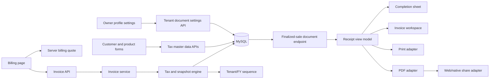
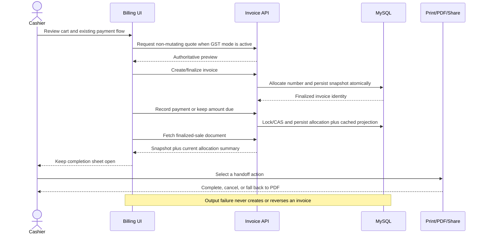
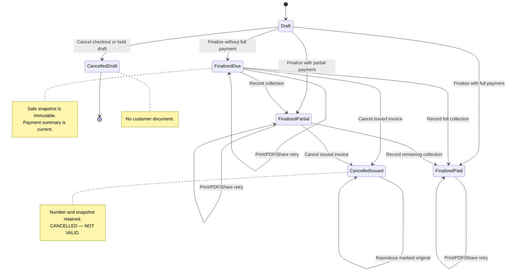

# Provable Sale Closure - Plan

## Goal Capsule

**Objective:** Replace handwritten carbon-copy bills with searchable, calculation-consistent customer documents and reliable records of paid, partially paid, and unpaid sales.

**Means:** Add a compact sale-completion sheet and detailed receipt workspace backed by an immutable server document projection and shared output adapters (KTD4, KTD5).

**Product authority:** Cashiers complete and hand off sales; owners configure the tenant's document format and tax identity. Existing role permissions remain authoritative.

**Open blockers:** None before implementation planning.

---

## Product Contract

### Summary

Every finalized sale will produce a durable customer document that can be printed, downloaded as a PDF, shared through the device, and found again later. The document preserves the original sale while showing the latest payment position for credit and partially paid invoices.

### Problem Frame

The current handwritten bill process gives the customer an original and keeps a carbon copy at the shop. Finding an old bill is slow, manual calculations can be wrong, and unpaid or partially paid amounts are difficult to reconcile confidently.

The application already finalizes invoices and records payments, but checkout does not provide a complete customer handoff or a reliable way to reproduce the bill. A successful digital sale therefore still depends on a separate manual record.

### Key Decisions

- **Receipt-only first release.** (session-settled: user-directed — chosen over manual-first or automatic UPI confirmation: customer handoff improves without changing payment confirmation.) Governs R1, R2, R15.
- **Print, PDF, and device share are the handoff methods.** (session-settled: user-directed — chosen over print-only or direct WhatsApp integration: the same workflow must serve web and mobile without a messaging-provider dependency.) Governs R3, R12, R13.
- **Every finalized sale has one customer document.** (session-settled: user-directed — chosen over paid-only documents or separate invoice and receipt records: outstanding money must remain visible with the original sale.) Governs R1, R7.
- **Checkout uses a completion sheet and history uses a detailed workspace.** (session-settled: user-approved — chosen over only a sheet or only a dedicated page: counter work stays fast while old bills remain recoverable.) Governs R2, R3, R4.
- **Each tenant chooses Simple Receipt or GST Tax Invoice.** (session-settled: user-directed — chosen over one universal format: shops need either a basic bill or a tax-compliant document.) Governs R8, R9, R10, R11.
- **Sale facts are frozen while the payment summary stays current.** (session-settled: user-directed — chosen over a fully frozen document or separate payment receipts: the original transaction remains trustworthy while the amount due remains useful.) Governs R5, R6, R7.
- **Printing remains a deliberate cashier action.** (session-settled: user-directed — chosen over automatic printing: browsers and mobile devices must behave consistently.) Governs R2, R14.

### Actors

- A1. **Cashier:** Finalizes a sale and chooses how to hand the document to the customer.
- A2. **Owner:** Configures the shop identity, receipt mode, and GST information, and can retrieve historical documents.
- A3. **Customer:** Receives a printed, downloaded, or device-shared copy showing the sale and current payment position.
- A4. **Kirana POS:** Calculates the bill, preserves the sale facts, and derives the current payment summary.

### Requirements

**Sale completion and recovery**

- R1. Every finalized invoice must produce one searchable customer document labelled `PAID`, `PARTIALLY PAID`, or `AMOUNT DUE` from its current payment position.
- R2. Successful checkout must show a completion sheet with Print, PDF, Share, View Bill, and New Sale actions, and it must remain visible until the cashier deliberately chooses the next action.
- R3. Reopening an invoice must show a detailed receipt workspace with the same Print, PDF, and Share handoff methods.
- R4. A failed or cancelled Print, PDF, or Share attempt must not reverse or duplicate the sale and must remain retryable from the invoice.

**Document truth and calculations**

- R5. Finalization must freeze the shop identity, customer reference, item descriptions, quantities, prices, discounts, tax facts, and totals used for that sale.
- R6. A reopened document must show current payment allocations, paid amount, remaining amount, and an `as of` timestamp without changing the facts governed by R5.
- R7. The completion sheet, detailed workspace, print output, PDF, and shared document must use the same system-calculated totals and payment status.

**Tenant-configurable formats**

- R8. The owner must be able to choose Simple Receipt or GST Tax Invoice as the tenant default for future sales without reformatting historical sales.
- R9. A Simple Receipt must show shop identity, invoice number and date, customer or walk-in status, line items, subtotal, discount, total, payment mode, payment status, paid amount, remaining amount, and the configured footer.
- R10. A GST Tax Invoice must additionally show the applicable GST identity and address, place of supply, HSN, taxable values, tax rates, CGST and SGST or IGST, and line-level tax facts frozen at finalization.
- R11. A historical sale that lacks the facts required by R10 must retain its original non-GST presentation and must not be relabelled as a GST Tax Invoice.

**Output and device behaviour**

- R12. Print output must support practical 58 mm and 80 mm thermal layouts, while PDF output must remain readable on A4 and mobile screens.
- R13. Share must use the device or browser share capability when available and fall back to downloading the PDF when sharing is unavailable or cancelled.
- R14. The first release must not print automatically after checkout.

**Existing boundaries**

- R15. This feature must not change how Cash, UPI, Credit, or Split payments are confirmed or recorded.
- R16. Existing tenant isolation and invoice permissions must govern document lookup and handoff, and a walk-in document must not invent customer identity data.

### Key Flows

- F1. **Finalize and hand off a paid sale. Covers R1, R2, R7, R14, R15.** The cashier finalizes the invoice, sees the completion sheet, chooses one handoff action, and then starts a new sale or opens the full bill.
- F2. **Recover an old bill. Covers R3, R4, R5, R7, R16.** An authorized user finds the invoice through existing invoice search, opens its receipt workspace, and retries the required handoff without creating another sale.
- F3. **Revisit a credit sale after collection. Covers R1, R5, R6, R7.** The document keeps its original sale facts while its payment summary shows the later collection, remaining amount, and current `as of` time.
- F4. **Change the tenant document format. Covers R8, R9, R10, R11.** The owner changes the default, future finalized sales use the new format, and older documents keep the format supported by their frozen facts.
- F5. **Share from an unsupported device. Covers R4, R12, R13.** The user selects Share, the system cannot invoke device sharing, and a PDF download remains available without affecting the invoice.

```text
Checkout succeeds
       │
       ▼
┌───────────────────────────────────────┐
│ Sale complete                         │
│ Invoice · Total · Paid/Due · Status   │
│                                       │
│ [Print] [PDF] [Share] [View Bill]     │
│                         [New Sale]    │
└───────────────────────────────────────┘
       │                    │
       │ View Bill          └── New Sale → clean billing screen
       ▼
┌───────────────────────────────────────┐
│ Detailed receipt workspace            │
│ Frozen sale facts                     │
│ Current payment summary + as-of time  │
│ [Print] [PDF] [Share]                 │
└───────────────────────────────────────┘
```

### Acceptance Examples

- AE1. **Paid walk-in sale. Covers R1, R2, R7, R9, R16.** Given a walk-in customer pays the full amount in cash, finalization shows a `PAID` Simple Receipt with no invented customer name and offers all completion actions.
- AE2. **Partially paid named sale. Covers R1, R2, R6, R7.** Given a named customer pays only part of the invoice, the document shows `PARTIALLY PAID`, the paid amount, and the remaining amount.
- AE3. **Later credit collection. Covers R5, R6, R7.** Given payment is recorded after a credit sale, reopening the document preserves the original items and totals but shows the latest paid and remaining amounts with an `as of` timestamp.
- AE4. **GST sale survives a later settings change. Covers R5, R8, R10.** Given a GST invoice was finalized and the owner later changes tax or shop settings, the historical document continues to show the tax and shop facts captured at finalization.
- AE5. **Failed printer or cancelled share. Covers R3, R4, R13.** Given handoff fails after finalization, the invoice remains recorded once and the user can reopen it to retry or download the PDF.
- AE6. **Legacy sale. Covers R8, R11.** Given an older sale lacks frozen HSN or line-tax facts, opening it produces its supported non-GST document rather than manufacturing a GST Tax Invoice.
- AE7. **Output layouts. Covers R7, R12.** Given the same invoice is printed at 58 mm or 80 mm and downloaded as A4 PDF, all versions show matching figures without clipped required information.

### Success Criteria

- A cashier can finish the normal customer handoff from the completion sheet without navigating away from billing unless View Bill is selected.
- An authorized user can find an old invoice through the existing invoice experience and reproduce its customer document.
- Totals, payment status, paid amount, and remaining amount agree across checkout, invoice history, print, PDF, and share outputs.
- A credit invoice reopened after a later payment retains the original sale while clearly showing the updated amount due.
- Both receipt formats remain usable on supported mobile, tablet, and desktop layouts and on the required print widths.

### Scope Boundaries

**Included**

- The post-checkout completion sheet and detailed historical receipt workspace.
- Tenant-configurable Simple Receipt and GST Tax Invoice formats.
- Frozen sale facts with a current payment summary.
- Manual print, PDF download, and device share.

**Deferred**

- Direct WhatsApp Business integration and automated message delivery.
- Automatic printing and printer-specific hardware integration.
- Payment-provider or bank verification for UPI.
- Hosted public receipt links, email delivery, and scheduled reminders.

**Outside this release**

- Returns, refunds, corrected invoices, cancellation documents, and credit notes.
- Offline sale synchronization, accounting exports, and customer-app changes.

### Dependencies and Assumptions

- Existing invoice search remains the entry point for finding old bills.
- Existing payment records remain the authority for the live payment summary.
- The tenant can supply the shop identity and, when GST mode is selected, the legally required tax details.
- Common 58 mm and 80 mm thermal printers and A4 PDF are the initial output targets; printer-model certification is not included.

### Sources / Research

- `src/features/billing/BillingPage.tsx` — current checkout success, payment retry, and billing reset behaviour.
- `src/features/billing/BillingPage.test.tsx` — current invoice reuse after payment failure.
- `src/pages/InvoiceDetailPage.tsx` — current historical invoice and payment presentation.
- `src/components/products/ProductBarcodeLabelModal.tsx` — current print-only browser pattern.
- `kirana-server/prisma/schema.prisma` and `kirana-server/src/modules/invoice/` — current tenant, invoice, item, and payment persistence boundaries.
- `kirana-server/src/modules/tenant-backup/` — strict backup allowlists and restore transaction behaviour that new persistent fields must preserve.
- [CBIC GST Invoice Rules](https://cbic-gst.gov.in/gst-invoice-rules.html) — authoritative invoice particulars, numbering, tax, and place-of-supply requirements adopted by KTD2 and KTD6.
- [MDN Web Share API](https://developer.mozilla.org/en-US/docs/Web/API/Navigator/share) — secure-context, user-activation, file-sharing, capability-detection, and cancellation constraints adopted by KTD5.
- [React PDF components](https://react-pdf.org/docs/v2/components) and [font registration](https://react-pdf.org/docs/v4/fonts) — browser PDF generation and bundled multilingual-font support adopted by KTD5.
- [Capacitor Share](https://capacitor-site.vercel.app/docs/v5/apis/share) and [Filesystem](https://capacitor-site.vercel.app/docs/v5/apis/filesystem) — native PDF handoff and temporary-file lifecycle adopted by KTD5.

Product Contract unchanged.

---

## Planning Contract

### Key Technical Decisions

- KTD1. **Persist normalized invoice snapshots only after finalization is claimed.** Add explicit header and line snapshot columns rather than an opaque JSON blob so tax facts remain validated, queryable, restorable, and stable when master data changes. Every direct or draft finalization must first claim the tenant-owned invoice with a status/version compare-and-swap inside the same transaction that writes number, snapshots, inventory, ledger, and customer balance. Historical rows remain nullable and render through the legacy Simple Receipt path. Implements R5, R6, R8, R10, R11, and R16.
- KTD2. **Make the server authoritative for tax-exclusive GST calculations.** Preserve the current tax-exclusive selling-price meaning. In GST mode, calculate with exact decimal or integer-paise arithmetic: gross equals unit price times quantity; discounts cannot exceed their base; bill discount is apportioned by largest fractional remainder with stable line order; each tax component is rounded once; header values must exactly equal frozen line sums. Supplier and place-of-supply state codes select CGST plus SGST or IGST, and client aggregate GST is rejected. Implements R7 and R10 and binds the particulars defined by the [CBIC GST Invoice Rules](https://cbic-gst.gov.in/gst-invoice-rules.html).
- KTD3. **Persist tenant document settings separately from Tenant and advertise capability from deployment configuration.** A one-to-one tenant settings record stores document mode, supplier/tax identity, optional footer, signatory, default paper width, and version metadata. Authenticated billing users may read it, while only the existing settings permission may update it. A read-only server capability, excluded from owner updates and tenant backups, controls staged GST activation until required legal fields validate. Implements R8, R9, R10, R12, and R16.
- KTD4. **Expose a dedicated finalized-sale document read model.** Add a tenant-scoped, permission-protected document endpoint rather than overloading invoice CRUD and held-bill responses. Read snapshot and allocation rows in one consistent database transaction, derive returned paid, remaining, and payment status from those allocations, and use cached invoice fields only as an integrity check. Return last-allocation time, projection time from the same read, and a legacy marker; one UI mapper supplies completion, history, print, PDF, and share. Implements R1, R5, R6, R7, and R16.
- KTD5. **Render output through replaceable client adapters.** One semantic receipt component owns visible fields, print CSS owns 58 mm and 80 mm output, a lazily loaded React PDF document owns A4/PDF output, and share adapters use Web Share when `navigator.canShare()` accepts the PDF or Capacitor Filesystem plus Share on native devices; unsupported or cancelled share falls back to a downloaded PDF. Implements R3, R4, R12, R13, and R14.
- KTD6. **Issue invoice numbers only at successful finalization.** Drafts use their database identity or a non-legal draft reference. Finalization uses an `Asia/Kolkata` issue instant to allocate an atomic tenant/April–March-financial-year sequence inside the sale transaction, with composite tenant/invoice uniqueness and a maximum 16-character number. Existing draft references remain recoverable but are not treated as issued GST numbers. Implements R5, R9, R10, and R16.
- KTD7. **Ship an additive migration with explicit v1/v2 backup contracts.** Use separate strict parsers and per-version checksum collection order, then normalize into one restore model. V2 includes settings, tax master data, snapshots, and sequences; v1 preserves current settings, supplies no invented GST facts, and initializes a new-format sequence without parsing legacy monthly numbers. Restore never lowers a sequence below either its archived or derived next value. Implements R5, R8, R11, and R16.
- KTD8. **Use the same tax engine and a canonical quote fingerprint for quote and finalization.** GST quote returns an opaque fingerprint over settings version, customer/place-of-supply facts, ordered variant and tax inputs, quantities, discounts, and totals. Finalization requires that fingerprint and quoted payable amount, recomputes inside the sale transaction, and returns a typed conflict if either differs. Implements R7, R10, and R15.
- KTD9. **Separate legal invoice state from customer-facing payment state.** Drafts return a typed non-document result. An issued invoice remains retrievable after later cancellation, retains its number, and renders the original projection with a prominent `CANCELLED — NOT VALID` marker; this is not a separate cancellation document or credit note. Otherwise, invoice status `FINALIZED` produces a document labelled from payment status as `AMOUNT DUE`, `PARTIALLY PAID`, or `PAID`. Implements R1, R3, R11, and R15.

### High-Level Technical Design

The component topology below is the ownership boundary for calculations and presentation.



The checkout protocol commits the sale before any handoff action and never repeats finalization when an output fails.



Invoice lifecycle and customer-document availability are coupled as follows.



Output selection follows this decision matrix.

| Context | Document facts | Output path | Failure behaviour |
| --- | --- | --- | --- |
| Current Simple Receipt | Frozen simple snapshot | Completion or history → print/PDF/share | Retry from the same invoice |
| Current GST Tax Invoice | Frozen tax snapshot | Completion or history → print/PDF/share | Retry from the same invoice |
| Legacy invoice | Live-compatible legacy projection, labelled non-GST | History → print/PDF/share | Never upgrade it to GST |
| Draft or pre-issuance cancellation | Typed non-document result | Existing draft/cancel UI only | No customer-document actions |
| Issued invoice later cancelled | Frozen original with `CANCELLED — NOT VALID` | History → print/PDF/share | Number is retained and never reused |
| Web with file share | PDF blob accepted by `navigator.canShare()` | Native browser share sheet | Cancellation downloads the PDF |
| Web without file share | Same PDF blob | Direct download | Invoice remains unchanged |
| Capacitor native | PDF written to temporary cache | Capacitor Share sheet | Cancellation downloads the PDF and cleans up best-effort |

### Implementation Constraints

- Preserve all existing payment choices, payment-recovery idempotency, held-bill behaviour, and tenant filters per R4, R15, and R16.
- Carry `tenant_id` through every settings, sequence, invoice, payment, allocation, customer, and variant read or mutation, including transaction-time compare-and-swap and restore validation.
- Perform claim, invoice number allocation, snapshot creation, inventory mutation, customer balance mutation, ledger mutation, and finalization in one database transaction; partial persistence is not acceptable.
- Use one exact money representation throughout KTD2 and KTD8; converting Prisma decimals to binary floating-point before financial calculation is prohibited.
- Keep document preferences out of JWT claims and local-only settings because they are tenant data shared by all counters.
- Lazy-load the PDF renderer and font assets so ordinary billing and navigation do not absorb their startup cost.
- Bundle static, non-variable fonts that cover English, Hindi, Marathi, and Gujarati; never depend on a remote font request while producing a bill.
- Add every new user-facing string to `en`, `hi`, `mr`, and `gu`, and keep the localization-coverage test passing.
- Move focus to the completion heading after success, announce status and amount due, expose labelled busy states, preserve visible keyboard focus and logical order, restore focus after dialogs, and keep interactive targets at least 44 by 44 CSS pixels.
- Treat “GST Tax Invoice” as document formatting and calculation support, not certification; a qualified tax reviewer must validate the final field set and sample output before a production compliance claim.

### Sequencing

1. Land and deploy the additive server migration, tenant settings, tax master data, snapshot engine, document DTO, and backup compatibility before releasing UI controls that depend on them.
2. Add UI configuration and master-data capture after the server contract is available, keeping GST mode unavailable until the tenant profile validates.
3. Add the shared receipt model and output adapters before wiring checkout and invoice history, so every surface consumes the same representation.
4. Deploy a backward-compatible UI, validate locally and against Railway, then set and verify `RECEIPT_DOCUMENTS_ENABLED=true`; keep Netlify production release manual and revert the flag before any pre-cutover server rollback.

### System-Wide Impact

- **Data lifecycle:** Tenant, customer, product, variant, invoice, invoice-item, payment projection, backup, restore, and invoice-number sequencing all change; finalized snapshots are append-only evidence, not editable master data.
- **Authorization:** Existing invoice permissions continue to protect document reads and outputs; existing settings permission protects tenant document configuration; every new query remains tenant-scoped.
- **Performance:** Invoice detail adds allocations and snapshot fields, while PDF code and fonts remain outside the initial route bundle through dynamic import.
- **Compatibility:** Existing invoice CRUD and held-bill responses remain additive and unchanged; the document endpoint applies to issued invoices, including later-cancelled invoices under KTD9. Backup v1 archives, Simple Receipt tenants, and current payment flows keep working.
- **Operations:** Server schema and API deploy before UI; UI production deployment stays manual to conserve Netlify allowance and follows local plus Railway-backed verification.

### Risks and Mitigations

- **GST requirements may change or vary by business case.** Bind the implementation to the cited CBIC rules, keep e-invoice/IRN outside scope, and require tax-review sign-off on representative samples.
- **Discount allocation can create paise mismatches.** Use deterministic remainder allocation and assert that header taxable and tax totals equal the sum of line snapshots.
- **Concurrent finalization or payment can duplicate effects or lose allocations.** Claim finalization and payment eligibility with tenant/status/version guards inside their transactions, then reconcile stock, ledgers, allocation sums, cached paid amount, and status.
- **A concurrent counter can request the same invoice number.** Allocate the sequence within the finalization transaction and enforce composite uniqueness at the database layer.
- **Multilingual glyphs can disappear from PDFs.** Bundle and register tested fonts for all supported scripts and compare rendered PDFs in browser verification.
- **Browser and native sharing differ.** Feature-detect file share, require a user gesture, treat cancellation as non-destructive, and retain PDF download as the universal fallback.
- **Legacy backup restore can overwrite newer configuration.** Version the archive, validate allowed fields, preserve current settings for v1 input, and exercise transactional round trips.
- **Thermal printer drivers can ignore browser paper settings.** Provide exact 58 mm and 80 mm print CSS, a print preview selector, and manual verification on at least one representative printer or system-PDF print dialog per width.
- **A rollback after numbering cutover can corrupt the legal sequence.** Before the first new-format invoice, the capability can be disabled and the compatible server rolled back; afterwards keep additive data in place and roll forward, or temporarily disable finalization while repairing the new server.

### Alternatives Considered

- **Opaque JSON snapshots:** Rejected because validation, reporting, backup allowlisting, migrations, and tax-field inspection become harder than normalized columns.
- **Render from live tenant and catalog records:** Rejected because later edits would silently rewrite historical sale evidence.
- **Server-generated PDF:** Deferred because the existing Ionic client can produce the same document locally without server rendering infrastructure or cold-start cost; the server remains the data authority.
- **Browser print-to-PDF only:** Rejected because it does not provide a consistent PDF file for native sharing and makes fallback behaviour browser-specific.
- **Direct WhatsApp delivery:** Deferred because it introduces provider onboarding, message templates, consent, delivery tracking, and recurring cost beyond customer handoff.

---

## Implementation Units

### U1. Add durable document storage, numbering, and backup compatibility

**Goal:** Create the additive data foundation required to preserve finalized bill facts and tenant-level document configuration.

**Requirements:** R5, R8, R10, R11, R16; F4; AE4, AE6; KTD1, KTD3, KTD6, KTD7.

**Files:**

- `kirana-server`: `prisma/schema.prisma`, including the existing invoice `version` concurrency token, and a new `prisma/migrations/<timestamp>_add_sale_document_snapshots/migration.sql`.
- `kirana-server`: `src/modules/tenant-backup/tenant-backup.archive.ts`, `tenant-backup.service.ts`, and their tests.
- `kirana-server`: `src/database/seedDemoData.ts` only if existing demo records must populate optional master fields.

**Approach:** Add a one-to-one tenant document settings table, customer tax/address fields, product HSN, variant UQC/unit and tax fields, normalized invoice/header and invoice-item snapshots, distinct bill-discount and allocated-discount fields, immutable `issued_at`, and a tenant/financial-year sequence. Reuse the invoice integer `version`: every successful claim increments it exactly once and stale expected versions conflict. Audit existing numbers before replacing global uniqueness with composite tenant uniqueness. Give legacy formats and new financial-year numbers non-colliding shapes. Implement discriminated v1/v2 backup schemas, version-specific checksums, semantic pre-delete validation, and sequence restore as the greater of archived and derived next values.

**Execution note:** Write migration and backup compatibility tests before changing restore behaviour because a failure can lose or misattribute tenant data.

**Test scenarios:**

- Applying the migration to a database with legacy invoices succeeds without inventing snapshot or GST data.
- The pre-migration audit fails safely on duplicate or unclassifiable same-tenant numbers before changing constraints.
- Two tenants may own the same display invoice number, while duplicates inside one tenant are rejected.
- Drafts and pre-issuance cancellations consume no legal sequence value; an invoice cancelled after issuance retains its number permanently. Concurrent finalizations return distinct consecutive numbers at the April–March boundary in `Asia/Kolkata`.
- A failed finalization rolls back the sale but does not permit duplicate issuance when retried under the selected sequence-locking strategy.
- A v2 export and restore preserves settings, tax master data, snapshots, and the next sequence value.
- A v1 restore succeeds, preserves current tenant settings, restores legacy invoices as non-GST, and resumes numbering without collision.
- Archives with duplicate numbers, cross-tenant references, impossible money, allocation/header mismatch, incomplete current GST snapshots, or a regressed sequence fail before deletion.
- An insert failure rolls back settings, sequence, invoices, items, payments, allocations, inventory, and ledgers together.

**Verification:** Targeted Prisma/Jest tests, guarded backup round-trip against disposable `TEST_DATABASE_URL`, server build, and inspection of generated SQL for additive-only behaviour.

### U2. Add tenant document settings and tax master-data APIs

**Goal:** Let owners configure a valid receipt profile and capture the customer and product facts required for future GST documents.

**Requirements:** R8, R9, R10, R12, R16; F4; AE4; KTD3.

**Files:**

- `kirana-server`: new `src/modules/tenant-settings/` route, controller, service, repository, validation, and tests; `src/routes/index.ts`.
- `kirana-server`: `src/config/env.ts` and environment documentation for deployment-owned `RECEIPT_DOCUMENTS_ENABLED`.
- `kirana-server`: `src/modules/customer/customer.validation.ts`, `customer.controller.ts`, `customer.service.ts`, `customer.repository.ts`, and tests.
- `kirana-server`: `src/modules/product/product.validation.ts`, `product.controller.ts`, `product.service.ts`, `product.repository.ts`, variant handling, and tests.

**Approach:** Add tenant-scoped read and permission-protected update endpoints. Advertise read-only `RECEIPT_DOCUMENTS_ENABLED`, defaulting false, from validated server configuration; exclude it from owner updates and backup data. Validate GSTIN/state-code formats and prevent GST-mode activation until required supplier fields are complete and the capability is enabled. The footer remains optional. Extend customer and product APIs with optional recipient GST/address and product HSN; keep UQC/unit and the existing tax rate on the sellable variant because packaging varies by variant.

**Test scenarios:**

- Owner can update the tenant's Simple Receipt profile and an authorized cashier can read the active profile.
- Cashier cannot change tenant settings, and a user from another tenant cannot read or mutate them.
- GST mode activation fails with field-specific validation when required supplier GSTIN, address, state, or signatory information is incomplete; an empty optional footer remains valid.
- GST mode activation fails while the deployment capability is disabled, and defaults paper width to either 58 mm or 80 mm with a valid per-print override contract.
- Valid customer GST/address and product HSN/unit/tax values round-trip through create, edit, and read APIs.
- Existing customer and product payloads without tax fields remain valid in Simple Receipt mode.

**Verification:** Targeted settings, customer, and product Jest suites plus server lint and build.

### U3. Build the server tax, snapshot, and document pipeline

**Goal:** Finalize every sale into a stable customer-document snapshot and return a single authoritative document representation with current payment facts.

**Requirements:** R1, R4, R5, R6, R7, R9, R10, R11, R15, R16; F1, F2, F3; AE1–AE6; KTD1, KTD2, KTD4, KTD6, KTD8, KTD9.

**Files:**

- `kirana-server`: `src/modules/invoice/invoice.validation.ts`, `invoice.service.ts`, `invoice.repository.ts`, `invoice.controller.ts`, `invoice.routes.ts`, and invoice tests, including the non-mutating quote and finalized-document routes.
- `kirana-server`: new focused modules under `src/modules/invoice/` for tax calculation, snapshot construction, numbering, and document projection.
- `kirana-server`: `src/modules/payment/payment.repository.ts` and `payment.service.ts` where allocation projection is needed.

**Approach:** Characterize current direct-finalization, ordinary-draft, held-draft, stock, customer-balance, and payment-retry behaviour first. Require every finalization path to claim tenant/status/version inside its transaction before number, calculation, snapshot, inventory, ledger, and balance effects. Serve quotes and finalization from KTD2's same tax engine and enforce KTD8's fingerprint conflict. Expose the document through a dedicated consistent-read path joined through tenant-scoped `invoice_payments`. Make payment eligibility and allocation update concurrency-safe, keep cached paid/status values reconciled to allocation sums, return a typed non-document result for drafts, and retain a marked projection for issued invoices later cancelled.

**Execution note:** Use test-first development for tax arithmetic, sequence allocation, and both finalization paths because these are financial invariants.

**Test scenarios:**

- A paid walk-in Simple Receipt finalizes without customer identity and returns `PAID` with matching totals.
- A named unpaid sale returns `AMOUNT DUE`; a partial payment returns `PARTIALLY PAID` with exact paid and remaining amounts.
- Direct `FINALIZED` creation and `DRAFT` then finalize persist equivalent snapshots and preserve existing inventory and ledger effects.
- Two concurrent finalizers produce one success, one conflict, one number, one snapshot, one stock change, and one ledger/customer-balance effect.
- Intra-state GST produces CGST plus SGST, while inter-state GST produces IGST from supplier and place-of-supply state codes.
- Tax-exclusive quotes and finalization agree for zero discount, maximum valid discount, one-paise remainder, multiple tax rates, and repeated calculation; a stale quote is rejected for review.
- A fingerprint conflict is returned when tenant settings, customer/place of supply, variant tax data, payable total, or ordered lines differ between quote and finalization; unchanged direct and draft paths succeed.
- Item discount and bill-level discount provenance remain distinct, and allocation preserves header-to-line equality at paise precision.
- Changing tenant, customer, product, or variant data after finalization does not change the document snapshot.
- A later collection changes allocations, status, paid amount, remaining amount, and `as of`, but no frozen field.
- Simultaneous payments cannot overpay, lose an update, or create a duplicate allocation; allocation sum, cached paid amount, and status remain equal.
- A legacy inconsistency audit identifies differences among cached paid amount, direct payment links, and allocation sums before the document capability is enabled.
- A failed payment retry reuses the invoice and never reallocates its number or duplicates stock/customer effects.
- Legacy rows with missing snapshot facts return a non-GST legacy DTO rather than fabricated tax data.
- Drafts return a typed non-document state; an issued invoice later cancelled keeps its number and returns its frozen projection with `CANCELLED — NOT VALID` on every output.
- A document read concurrent with payment is internally all-before or all-after that allocation and never combines mismatched totals or status.
- Cross-tenant lookup and document access are denied or return no record under the existing permission model.

**Verification:** Invoice and payment Jest suites, server lint/build, invariant queries comparing header/line and cached/allocation totals, and database-gated integration tests for concurrency, tenant isolation, sequence continuity across restart/year rollover, and transactional rollback through `TEST_DATABASE_URL`.

### U4. Add owner configuration and tax master-data fields to the POS

**Goal:** Give owners a clear configuration path while keeping cashier and Simple Receipt workflows uncluttered.

**Requirements:** R8, R9, R10, R12, R16; F4; AE4; KTD3.

**Files:**

- `kirana-ui`: new `src/core/api/tenantSettingsApi.ts` and tests; `src/core/api/apiSlice.ts`; `src/core/types/index.ts`.
- `kirana-ui`: `src/features/profile/ProfilePage.tsx`, `ProfilePage.css`, and a focused document-settings component with tests.
- `kirana-ui`: `src/features/customers/CustomersPage.tsx`, `src/features/products/ProductsPage.tsx`, `ProductDetailPage.tsx`, `AddProductBarcodePage.tsx`, plus `src/core/api/customerApi.ts` and `productApi.ts`.
- `kirana-ui`: `src/core/i18n/locales/{en,hi,mr,gu}.json` and `localizationCoverage.test.ts`.

**Approach:** Add an owner-only “Bill & GST settings” card to Profile instead of another primary navigation item. Reveal required GST fields when GST mode is selected, show activation blockers inline, and extend existing customer/product forms with optional advanced tax sections.

**Test scenarios:**

- Owner sees, edits, saves, and reloads tenant document settings; cashier can consume settings but cannot see edit controls.
- Selecting GST mode with incomplete details shows exact missing fields and does not activate the mode.
- Completing a valid GST profile activates the mode and does not change historical invoice display.
- Paper width defaults at tenant level and may be overridden for one print without changing the saved default.
- Customer and product forms save optional tax fields, while their current minimal Simple Receipt flows still pass.
- English, Hindi, Marathi, and Gujarati all contain the new labels and validation messages without hard-coded fallbacks.
- Settings and master-data controls have accessible names, keyboard order, visible focus, and error associations in all four languages.

**Verification:** Focused Vitest suites, localization coverage, UI lint, and UI build.

### U5. Create the shared receipt model and output adapters

**Goal:** Produce matching on-screen, thermal-print, PDF, and device-share representations from one authoritative document model.

**Requirements:** R3, R4, R7, R9, R10, R11, R12, R13, R14; F2, F5; AE5–AE7; KTD4, KTD5, KTD9.

**Files:**

- `kirana-ui`: new `src/features/invoices/receipt/` model, mapper, semantic document, styles, PDF document, output service, and tests.
- `kirana-ui`: `package.json`, lockfile, Capacitor configuration, and `android/` updates for Capacitor 5-compatible React PDF, Share, and Filesystem dependencies.
- `kirana-ui`: bundled font assets covering Latin, Devanagari, and Gujarati scripts.

**Approach:** Map the document DTO once into a receipt view model. Render that model through a semantic screen/print component and a lazily imported PDF component. Print CSS selects 58 mm or 80 mm; PDF produces A4. Model each output action as idle, generating, handing off, completed, cancelled, or recoverable error; prevent repeated activation while busy. Sharing chooses the supported web or native adapter and invokes PDF download after unsupported or cancelled sharing per R13.

**Test scenarios:**

- Simple, GST, and legacy DTOs map to the correct labels and required visible fields.
- Screen, print, and PDF presenters receive identical totals, payment status, and item values from the same model.
- The 58 mm and 80 mm layouts keep required fields inside their print area and the A4 document remains readable.
- Hindi, Marathi, and Gujarati sample receipts render without missing-glyph placeholders.
- Supported web file sharing receives one PDF file; unsupported or rejected sharing triggers download fallback.
- User cancellation downloads the PDF without an error toast that implies the sale failed, and no adapter mutates invoice state.
- Slow generation or handoff exposes an accessible busy state, blocks duplicate activation, and restores controls after completion, fallback, or error.
- Native share writes only a temporary PDF, invokes the share sheet, and cleans up best-effort after completion or cancellation.

**Verification:** Receipt Vitest suites, UI lint/build, bundle inspection proving lazy PDF chunking, and browser print/PDF snapshots for all target layouts and languages.

### U6. Keep the sale-completion sheet open after checkout

**Goal:** Complete customer handoff at the counter without losing the finalized invoice or slowing the next sale.

**Requirements:** R1, R2, R4, R7, R10, R14, R15; F1; AE1, AE2, AE5; KTD4, KTD5, KTD8, KTD9.

**Files:**

- `kirana-ui`: `src/features/billing/BillingPage.tsx`, `billing.logic.ts`, their tests, and a new focused completion-sheet component/styles/tests.
- `kirana-ui`: `src/core/api/invoiceApi.ts`, payment API integration, and shared types consumed by quote and finalized-document responses.

**Approach:** In GST mode, replace local/manual GST authority with the server quote and require place of supply plus complete customer/product tax facts when applicable. After finalization and successful payment or Pay Later, route to a completion state keyed only by invoice identity and fetch the dedicated document endpoint. Restore this state after refresh or app restoration until New Sale clears it. If the read fails, show `Sale saved, bill temporarily unavailable` with the known invoice/payment outcome and Retry Bill, View Bill, and New Sale; never repeat finalization or payment. Wire successful output actions to U5 and keep payment recovery separate so failure never shows false completion.

**Test scenarios:**

- Full cash or UPI payment shows a `PAID` sheet and preserves it through output actions until New Sale.
- Pay Later shows `AMOUNT DUE`; split or partial payment shows `PARTIALLY PAID` with exact figures.
- GST preview and finalization show the same total, and incomplete or changed tax data returns the cashier to review rather than opening payment with a stale amount.
- Walk-in checkout displays no invented customer, while a named credit sale displays the selected customer.
- View Bill navigates to the finalized invoice and browser Back returns predictably.
- New Sale clears the prior invoice once and restores a clean billing form.
- Payment failure keeps the current recovery UI, does not show completion, and retry reuses the pending invoice.
- Cancelling the payment prompt follows current cancellation behaviour, does not open the normal completion sheet, and leaves the issued invoice recoverable only through KTD9's marked historical projection.
- Document-fetch failure after a committed sale shows the recovery completion state and retry performs only the document read.
- Refresh or app restoration reconstructs completion from invoice identity; New Sale deliberately clears that recovery identity and the prior cart.
- Print/share cancellation leaves the completion sheet and invoice intact.
- Keyboard and screen-reader use announces sale status and due amount, reaches every action in order, and returns focus predictably after dialogs.

**Verification:** Billing Vitest suite plus browser testing at mobile, tablet, and desktop sizes against the configured server.

### U7. Upgrade invoice history into the detailed receipt workspace

**Goal:** Let authorized users retrieve any supported invoice, understand its original sale and current dues, and reproduce the customer document.

**Requirements:** R1, R3, R4, R5, R6, R7, R11, R12, R13, R16; F2, F3, F5; AE3, AE5–AE7; KTD4, KTD5, KTD9.

**Files:**

- `kirana-ui`: `src/features/invoices/InvoiceDetailPage.tsx`, `InvoiceDetailPage.css`, and `InvoiceDetailPage.test.tsx`.
- `kirana-ui`: `src/core/api/invoiceApi.ts` and tests/types.
- `kirana-ui`: `src/features/invoices/InvoicesPage.tsx` and its tests only where needed for current search-to-detail navigation.

**Approach:** Use the dedicated document endpoint and shared receipt view model for frozen sale content. Add a current-payment panel with allocation history, last-payment time, and projection time. Expose output controls, a visible legacy Simple Receipt marker when GST evidence is unavailable, and the KTD9 cancellation marker when an issued invoice was later cancelled. Keep existing invoice-list navigation behaviour; broader list-state persistence remains a separate navigation improvement.

**Test scenarios:**

- Reopening a finalized invoice shows the same frozen sale values as its completion sheet.
- A later payment appears as a new allocation and updates paid/remaining/status without altering the sale section.
- Legacy invoice opens as a supported non-GST receipt with no fabricated HSN or GST values.
- Owner, manager, and cashier access follows current invoice permissions; a cross-tenant invoice cannot be opened.
- Print, PDF, and Share actions reuse U5 and remain retryable after cancellation or failure.
- Invoice search opens detail and Back uses the application's current navigation mechanism without introducing URL persistence for customer search text.
- An issued invoice later cancelled remains retrievable and reproduces only with `CANCELLED — NOT VALID` across screen, print, PDF, and share.
- Mobile, tablet, desktop, 58 mm, 80 mm, and A4 layouts keep required content visible.
- Keyboard and screen-reader navigation can reach document sections and output actions with labelled busy/error states and visible focus.

**Verification:** Invoice UI Vitest suites and end-to-end browser checks across search, detail, later payment, navigation, and all output actions.

---

## Verification Contract

### Server gates

Run from `kirana-server`:

```bash
npm test -- --runInBand src/modules/tenant-settings src/modules/customer src/modules/product src/modules/invoice src/modules/payment src/modules/tenant-backup
npm run lint
npm run build
```

Run `npm run test:integration` only when `TEST_DATABASE_URL` points to a disposable MySQL database. The destructive tenant backup round-trip additionally requires its explicit safety flag and must be adapted to use that disposable database rather than ordinary `DATABASE_URL`. Database gates cover concurrent finalization and payments, restart/year-rollover sequence continuity, tenant isolation, rollback, invariant audits, v1/v2 parsing, invalid-archive rejection before deletion, and backup/restore without touching Railway demo data.

### UI gates

Run from `kirana-ui`:

```bash
npm test -- src/features/profile src/features/customers src/features/products src/features/billing src/features/invoices src/core/i18n/localizationCoverage.test.ts
npm run lint
npm run build
```

### Cross-repository behavioural gates

- Exercise one paid walk-in, one unpaid named customer, one partial payment, and one later collection against the same local UI/server pair.
- Confirm the database, invoice API, completion sheet, detailed workspace, print preview, PDF, and share payload agree on invoice number, line values, total, paid amount, and remaining amount.
- Change shop, customer, and product master data after finalization and confirm the historical sale section remains unchanged.
- Export tenant backup v2, restore it into a disposable tenant/database, and compare settings, invoice snapshots, allocations, and sequence continuity.
- Test English, Hindi, Marathi, and Gujarati on mobile, tablet, desktop, 58 mm, 80 mm, and A4 using a dedicated synthetic tenant and synthetic customers. Keep recorded screenshots and PDFs only in a private temporary location, redact accidental live identifiers, never commit them, and remove them after review because the repository has no visual-regression harness.
- Verify Web Share on a supported secure-context browser, download fallback on an unsupported browser, and Capacitor sharing on one Android device or emulator.
- Verify keyboard-only checkout and invoice-history handoff plus one screen-reader flow, including focus placement, announcements, busy states, and dialog return focus.
- Keep Netlify production deployment manual; release only after Railway migration/API health and local browser evidence pass.

---

## Definition of Done

- U1–U7 satisfy their stated requirements, tests, and verification checks in both repositories.
- Every finalized current-format invoice stores immutable sale facts and receives a tenant-scoped, collision-safe number.
- GST mode cannot activate or finalize an invoice without required supplier, recipient-when-applicable, place-of-supply, item, and tax facts.
- Paid, partially paid, and amount-due documents agree across all UI and output surfaces, including after a later collection.
- Legacy invoices and backup v1 archives remain usable without fabricated GST data.
- Authorization and tenant-isolation tests prove settings and documents cannot cross tenant boundaries.
- All four supported languages render on screen and in PDF without missing keys or glyphs.
- Thermal and A4 outputs pass representative visual inspection, and share fallback is non-destructive.
- Server migration and API changes are released before the manually triggered UI release, with a rollback path that disables the receipt workspace without deleting snapshot data.
- Before number cutover, exercise capability-off and compatible-server rollback; after the first new-format invoice, prohibit the legacy numbering server and document roll-forward or temporary finalization shutdown as the recovery path.
- Database backup is treated as disaster recovery, not routine deployment rollback, because restoring it can discard sales or payments created after the backup.
- README/handbook and `kirana-context` maps are updated with the document model, configuration, migration order, and demo flow after implementation behaviour is verified.
- Abandoned experiments, duplicate calculation paths, temporary flags no longer needed after rollout, and dead styles/tests are removed before merge.
